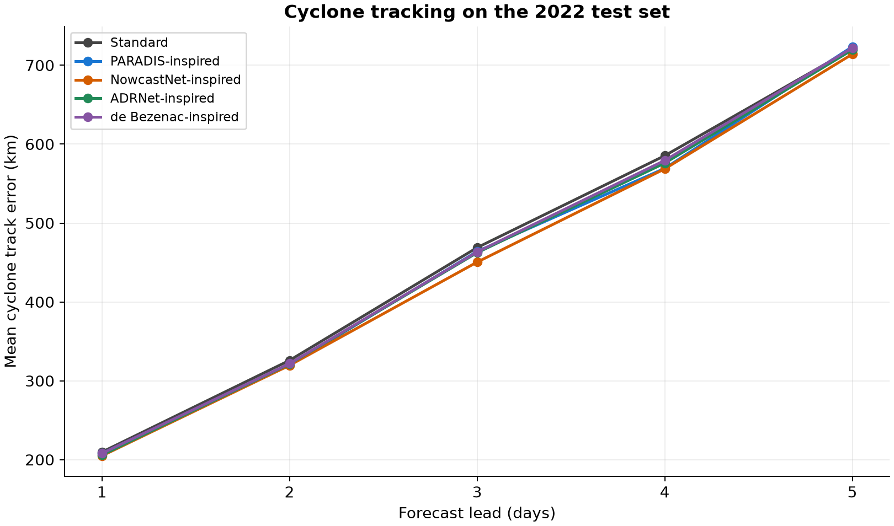
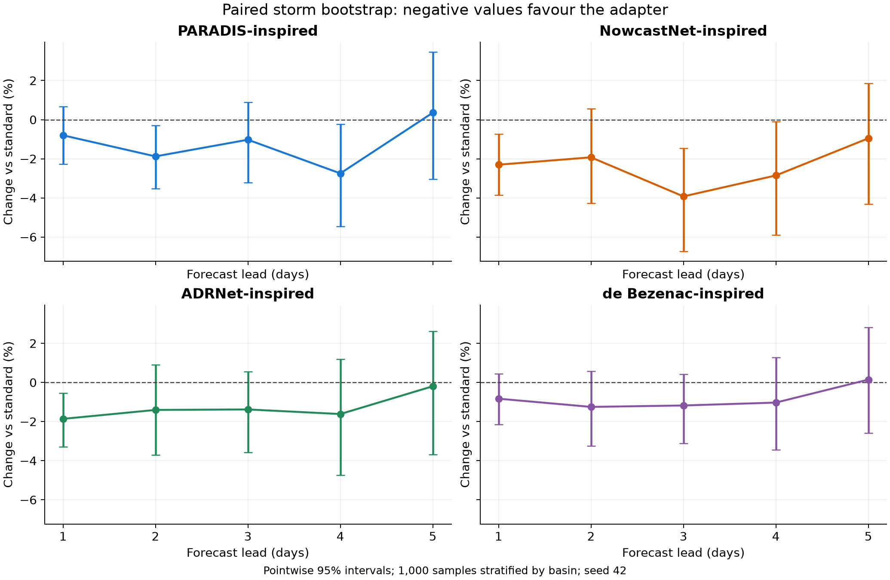
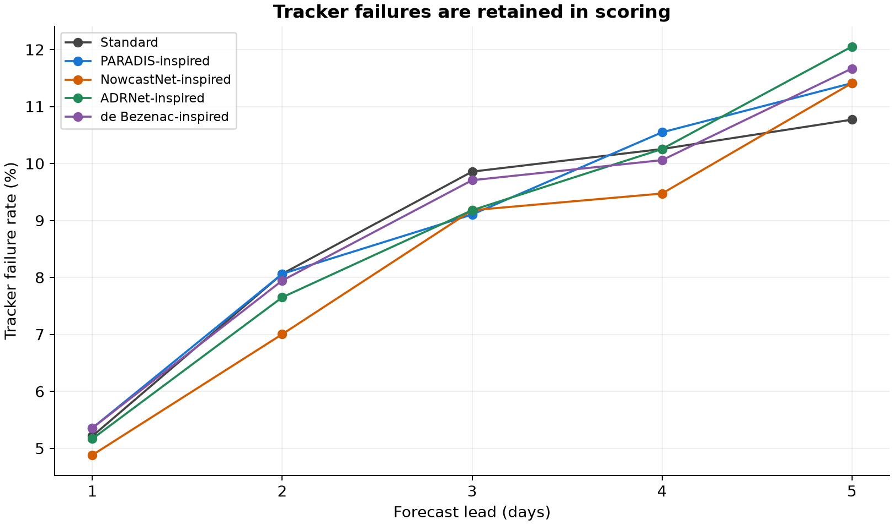
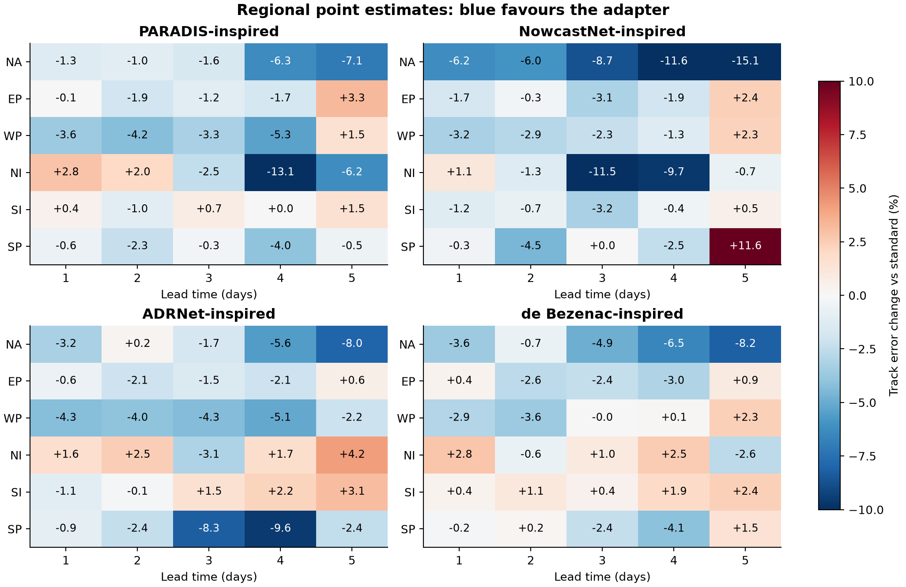
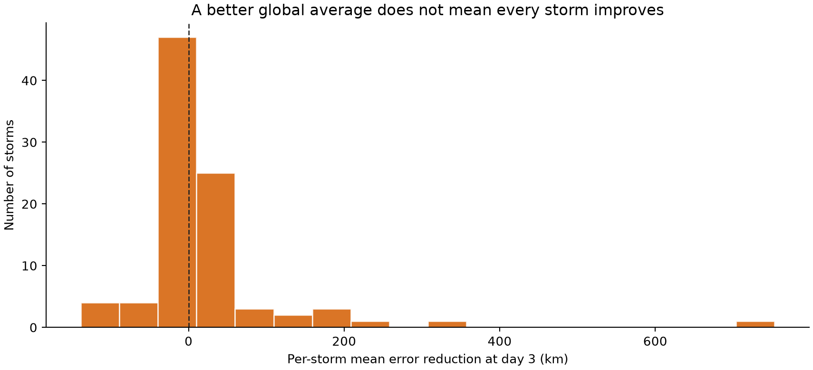
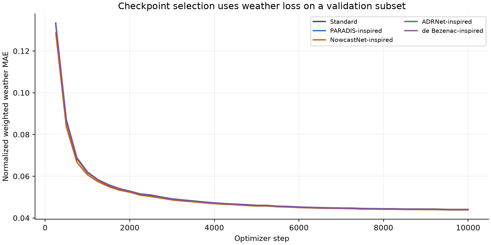

# Aurora cyclone tracking

This workflow compares standard Aurora fine-tuning with four transport variants at 1.5°. It tracks known tropical cyclones in forecast fields and measures their position error against observed IBTrACS tracks.

## Architecture and transport

Advection is the motion of a field with a flow. A backward sampler asks where the content at a destination came from. A forward operator asks where the content in a source cell goes. These operations matter for cyclone tracking because a shifted vortex and a smoothed or misplaced vortex can have similar global weather loss while producing different track errors.

Aurora encodes two consecutive weather states, evolves the latent representation with its Swin backbone, and decodes the next six-hour forecast. Here the original Aurora pretrained model runs on a **1.5° weather grid**, with 120 × 240 cells and 4 × 4 patches. The resulting 30 × 60 lattice has nominal 6° horizontal spacing. Aurora 1.5 is the name of a separate model release.

Each adapter adds a current-state feature encoder. A shared motion network uses past and current features plus projected backbone context. It predicts bounded east/north motion for feature groups and converts motion over the six-hour interval to spherical source or destination coordinates. The features are learned scalars. Their slots do not correspond to physical pressure levels.

~~~text
candidate = transport(current_features, motion) + local_update
forecast_features = backbone_features + tanh(gain) * lift(candidate - project(backbone_features))
forecast = Aurora_decoder(forecast_features)
~~~

The initial residual gain is small. The scalar interpolation wraps longitude and reflects at the poles with a half-turn. The area-weighted ADRNet push conserves the integral for that isolated transport step. The full residual forecast includes diffusion, reaction and decoder operations, so that property does not imply conservation of physical moisture or energy. See [operator details and paper sources](docs/METHODS.md).

| Variant | Operator | What changes during training |
|---|---|---|
| Standard | Original Aurora forecast | Full-parameter weather fine-tuning |
| PARADIS-inspired | Bicubic backward sampling, depthwise mixing and pointwise reaction | Learns motion and local feature evolution |
| NowcastNet-inspired | Nearest-neighbor backward transport and additive source | A second bilinear candidate adds a supervised loss so motion receives coordinate gradients. Evaluation uses the nearest branch. |
| ADRNet-inspired | Area-weighted bilinear forward splatting, implicit grid diffusion and reaction | Trains a push operator by default. The optional pull mode uses backward sampling. |
| de Bézenac-inspired | Normalized Gaussian sampling around a spherical departure point | Learns the displacement and Gaussian width on a local 7 × 7 support. |

## Data and training protocol

| Source | Role |
|---|---|
| WeatherBench 2 HRES-T0 | Six-hour atmospheric and surface input fields and forecast targets, regridded to 1.5° |
| ERA5 static fields | Land–sea mask, surface geopotential and soil type |
| NOAA IBTrACS v04r01 | Observed storm positions for track verification |

The weather store uses **2016–2020 training, 2021 validation and 2022 testing**. Runs share seed 42, 10,000 optimizer updates, BF16, activation checkpointing, a microbatch of one, and four microbatches per update. The two forward steps supervise +6 h and +12 h with gradients through both predictions. Checkpoint selection uses validation weather loss. NowcastNet's auxiliary objective and the other branches' motion penalty are relevant differences when attributing any gain to transport.

## Reproduce the five-way experiment

Run from the repository root on Linux. Use the PyTorch build for your GPU environment, and replace device index 2 with your assigned GPU.

~~~bash
cd aurora-cyclone-tracking
python3.11 -m venv .venv
source .venv/bin/activate
python -m pip install torch==2.6.0 torchvision==0.21.0 \
  --index-url https://download.pytorch.org/whl/cu124
python -m pip install -r requirements.txt

export CUDA_VISIBLE_DEVICES="$(nvidia-smi -i 2 --query-gpu=uuid --format=csv,noheader)"
python scripts/download_datasets.py --check-only
python scripts/download_datasets.py --source hres --config configs/cyclone.json
~~~

Confirm the prepared Zarr and IBTrACS table cover the configured dates. Check the year coverage explicitly if you copied an older CSV. The following loop uses the default output directories for fresh runs. To run only one variant, invoke the corresponding script by itself. A short test with a separate output folder can verify memory before a full training run.

~~~bash
for approach in standard paradis nowcastnet adrnet de_bezenac; do
  python "scripts/finetune_${approach}.py" --config configs/cyclone.json || break
done
~~~

Use **the same track file and lead convention for all checkpoints**. The recorded five-way comparison uses the zero issue-delay setting. For an interrupted job, use its original code revision, saved config, GPU count, output path, and latest checkpoint. Relocating source code changes the resume fingerprint. Existing weights can still be evaluated.

~~~bash
for approach in standard paradis nowcastnet adrnet de_bezenac; do
  python scripts/evaluate_cyclones.py \
    --checkpoint "runs/cyclone/${approach}_seed42/best.pt" \
    --ibtracs data/ibtracs.csv --leads 24 48 72 96 120 || break
done

python scripts/compare_results.py \
  --reference runs/cyclone/standard_seed42/cyclone_evaluation \
  --candidate runs/cyclone/paradis_seed42/cyclone_evaluation \
  --candidate runs/cyclone/nowcastnet_seed42/cyclone_evaluation \
  --candidate runs/cyclone/adrnet_seed42/cyclone_evaluation \
  --candidate runs/cyclone/de_bezenac_seed42/cyclone_evaluation \
  --output runs/cyclone_comparison.csv

mkdir -p local-artifacts
python scripts/export_results.py --runs runs/cyclone \
  --output local-artifacts/aurora_cyclone_results.zip
~~~

The evaluator starts from known storms and tracks local minima in forecast sea-level pressure and 700 hPa geopotential. If tracking fails, it holds the previous predicted position and flags the case. The distance metric uses that persisted position. Verification therefore measures tracking skill for initialized storms. See [full CLI options, resume and manual data preparation](docs/WORKFLOW.md).

## Results

See the [results-only README](results/README.md) for this evidence without the run steps.

Track MAE averages great-circle distances in kilometres. Track RMSE takes the square root of the mean squared distance, giving large misses more weight. A verification case is a storm, initialization and lead with an observed position. The paired bootstrap resamples storms within basins and preserves all the cases for each sampled storm.


**Experiment:** HRES-T0 at 1.5°; train 2016–2020, validation 2021, test 2022. All five methods completed 10,000 optimizer steps with seed 42.

### Main findings

- **NowcastNet-inspired has the lowest global mean track error at all five leads.** Its largest relative reduction is **3.92% at 72 hours**, from **468.82 to 450.43 km** (**18.39 km** lower). The nominal paired-bootstrap 95% interval for the relative change is **−6.73% to −1.46%**.
- Paired intervals lie entirely below zero for **NowcastNet-inspired at days 1, 3 and 4**, **PARADIS-inspired at days 2 and 4**, and **ADRNet-inspired at day 1**.
- No global lead-time interval for de Bézenac-inspired excludes zero.
- **No adapter has a conclusive day-5 improvement** under the reported intervals. PARADIS-inspired and de Bézenac-inspired have slightly higher day-5 point-estimate errors than standard.

### Global track error

Mean position error in **km**; lower is better. Bold entries are the lowest point estimates, not evidence of superiority over every other adapter.

| Approach | Day 1 | Day 2 | Day 3 | Day 4 | Day 5 |
|---|---:|---:|---:|---:|---:|
| Standard | 209.67 | 325.86 | 468.82 | 585.35 | 720.98 |
| PARADIS-inspired | 207.99 | 319.74 | 464.01 | 569.27 | 723.54 |
| NowcastNet-inspired | **204.84** | **319.58** | **450.43** | **568.65** | **714.10** |
| ADRNet-inspired | 205.77 | 321.28 | 462.35 | 575.90 | 719.57 |
| de Bezenac-inspired | 207.93 | 321.78 | 463.30 | 579.32 | 722.02 |



### Relative error change against standard

**Negative percentages favour the adapter.** An asterisk marks a nominal paired-bootstrap 95% interval entirely below zero. Intervals use 1,000 storm resamples stratified by basin; they are not adjusted for multiple comparisons.

| Approach | Day 1 | Day 2 | Day 3 | Day 4 | Day 5 |
|---|---:|---:|---:|---:|---:|
| PARADIS-inspired | -0.80% | -1.88% * | -1.03% | -2.75% * | +0.35% |
| NowcastNet-inspired | -2.30% * | -1.93% | -3.92% * | -2.85% * | -0.95% |
| ADRNet-inspired | -1.86% * | -1.41% | -1.38% | -1.61% | -0.20% |
| de Bezenac-inspired | -0.83% | -1.25% | -1.18% | -1.03% | +0.14% |



### Tracker failure rates

Percent of verifying cases flagged as failed at the scored step; lower is preferable. Failed cases remain in the distance scores.

| Approach | Day 1 | Day 2 | Day 3 | Day 4 | Day 5 |
|---|---:|---:|---:|---:|---:|
| Standard | 5.22% | 8.06% | 9.86% | 10.25% | 10.77% |
| PARADIS-inspired | 5.36% | 8.06% | 9.10% | 10.55% | 11.41% |
| NowcastNet-inspired | 4.88% | 7.00% | 9.18% | 9.47% | 11.41% |
| ADRNet-inspired | 5.17% | 7.65% | 9.18% | 10.25% | 12.05% |
| de Bezenac-inspired | 5.36% | 7.95% | 9.71% | 10.06% | 11.67% |

NowcastNet-inspired lowers the day-4 failure rate from **10.25% to 9.47%**, but raises the day-5 rate from **10.77% to 11.41%**. Failure-rate differences have not been tested for statistical uncertainty.



### Basin and storm results

Regional gains vary by basin and lead; the heatmaps show point estimates rather than significance. Long-lead regional samples can be small: day 5 includes only four South Pacific storms and eight North Atlantic storms.



At day 3, NowcastNet-inspired lowers the per-storm mean error for **56 of 91 storms** and increases it for **35**. The median per-storm error reduction is **4.87 km**. This equal-storm summary differs from the case-weighted global reduction of 18.39 km.



### Global scores and paired confidence intervals

Each row reports track MAE, the tracker failure rate, and the matched relative MAE change versus standard. The final column gives the nominal 95% paired interval in percentage points. Track MAE is in kilometres. The original CSV retains the absolute MAE intervals and exact precision.

<details>
<summary>Global (ALL)</summary>

| Approach | Lead | Track MAE (km) | Cases | Storms | Failure | Relative MAE change [95% CI] |
|---|---:|---:|---:|---:|---:|---:|
| Standard | 24 h | 209.67 | 2109 | 109 | 5.22% | Reference |
| Standard | 48 h | 325.86 | 1699 | 102 | 8.06% | Reference |
| Standard | 72 h | 468.82 | 1329 | 91 | 9.86% | Reference |
| Standard | 96 h | 585.35 | 1024 | 80 | 10.25% | Reference |
| Standard | 120 h | 720.98 | 780 | 62 | 10.77% | Reference |
| PARADIS | 24 h | 207.99 | 2109 | 109 | 5.36% | -0.80% [-2.28%, +0.68%] |
| PARADIS | 48 h | 319.74 | 1699 | 102 | 8.06% | -1.88% [-3.53%, -0.29%] |
| PARADIS | 72 h | 464.01 | 1329 | 91 | 9.10% | -1.03% [-3.23%, +0.90%] |
| PARADIS | 96 h | 569.27 | 1024 | 80 | 10.55% | -2.75% [-5.45%, -0.24%] |
| PARADIS | 120 h | 723.54 | 780 | 62 | 11.41% | +0.35% [-3.04%, +3.46%] |
| NowcastNet | 24 h | 204.84 | 2109 | 109 | 4.88% | -2.30% [-3.85%, -0.75%] |
| NowcastNet | 48 h | 319.58 | 1699 | 102 | 7.00% | -1.93% [-4.28%, +0.55%] |
| NowcastNet | 72 h | 450.43 | 1329 | 91 | 9.18% | -3.92% [-6.73%, -1.46%] |
| NowcastNet | 96 h | 568.65 | 1024 | 80 | 9.47% | -2.85% [-5.90%, -0.10%] |
| NowcastNet | 120 h | 714.10 | 780 | 62 | 11.41% | -0.95% [-4.32%, +1.86%] |
| ADRNet | 24 h | 205.77 | 2109 | 109 | 5.17% | -1.86% [-3.29%, -0.54%] |
| ADRNet | 48 h | 321.28 | 1699 | 102 | 7.65% | -1.41% [-3.71%, +0.90%] |
| ADRNet | 72 h | 462.35 | 1329 | 91 | 9.18% | -1.38% [-3.57%, +0.56%] |
| ADRNet | 96 h | 575.90 | 1024 | 80 | 10.25% | -1.61% [-4.73%, +1.18%] |
| ADRNet | 120 h | 719.57 | 780 | 62 | 12.05% | -0.20% [-3.68%, +2.61%] |
| de Bézenac | 24 h | 207.93 | 2109 | 109 | 5.36% | -0.83% [-2.16%, +0.45%] |
| de Bézenac | 48 h | 321.78 | 1699 | 102 | 7.95% | -1.25% [-3.24%, +0.57%] |
| de Bézenac | 72 h | 463.30 | 1329 | 91 | 9.71% | -1.18% [-3.11%, +0.42%] |
| de Bézenac | 96 h | 579.32 | 1024 | 80 | 10.06% | -1.03% [-3.45%, +1.27%] |
| de Bézenac | 120 h | 722.02 | 780 | 62 | 11.67% | +0.14% [-2.58%, +2.81%] |

</details>

### Basin-level paired comparisons

These rows report relative MAE versus standard with nominal 95% intervals and matched case counts. Negative values favor the transport variant.

<details>
<summary>East Pacific (EP)</summary>

| Approach | Lead | Cases | Relative MAE change [95% CI] |
|---|---:|---:|---:|
| PARADIS | 24 h | 500 | -0.07% [-3.54%, +3.74%] |
| PARADIS | 48 h | 428 | -1.91% [-4.22%, +0.58%] |
| PARADIS | 72 h | 359 | -1.16% [-3.38%, +1.46%] |
| PARADIS | 96 h | 291 | -1.72% [-4.94%, +1.86%] |
| PARADIS | 120 h | 229 | +3.25% [-0.79%, +7.83%] |
| NowcastNet | 24 h | 500 | -1.67% [-4.18%, +1.90%] |
| NowcastNet | 48 h | 428 | -0.30% [-4.42%, +4.16%] |
| NowcastNet | 72 h | 359 | -3.13% [-7.47%, +0.98%] |
| NowcastNet | 96 h | 291 | -1.91% [-6.67%, +3.10%] |
| NowcastNet | 120 h | 229 | +2.40% [-0.49%, +5.76%] |
| ADRNet | 24 h | 500 | -0.62% [-4.37%, +3.00%] |
| ADRNet | 48 h | 428 | -2.07% [-6.26%, +2.93%] |
| ADRNet | 72 h | 359 | -1.46% [-5.20%, +2.89%] |
| ADRNet | 96 h | 291 | -2.07% [-6.22%, +2.67%] |
| ADRNet | 120 h | 229 | +0.59% [-2.10%, +3.91%] |
| de Bézenac | 24 h | 500 | +0.37% [-1.83%, +2.90%] |
| de Bézenac | 48 h | 428 | -2.65% [-7.33%, +1.54%] |
| de Bézenac | 72 h | 359 | -2.35% [-7.20%, +0.89%] |
| de Bézenac | 96 h | 291 | -2.98% [-7.91%, +2.15%] |
| de Bézenac | 120 h | 229 | +0.87% [-3.26%, +6.04%] |

</details>

<details>
<summary>North Atlantic (NA)</summary>

| Approach | Lead | Cases | Relative MAE change [95% CI] |
|---|---:|---:|---:|
| PARADIS | 24 h | 266 | -1.26% [-6.66%, +2.59%] |
| PARADIS | 48 h | 209 | -1.03% [-3.97%, +0.29%] |
| PARADIS | 72 h | 160 | -1.60% [-7.05%, +3.55%] |
| PARADIS | 96 h | 123 | -6.27% [-11.69%, +3.13%] |
| PARADIS | 120 h | 94 | -7.06% [-11.00%, +1.53%] |
| NowcastNet | 24 h | 266 | -6.19% [-11.81%, -0.87%] |
| NowcastNet | 48 h | 209 | -5.99% [-11.26%, +1.12%] |
| NowcastNet | 72 h | 160 | -8.71% [-14.80%, -0.33%] |
| NowcastNet | 96 h | 123 | -11.64% [-17.04%, -2.17%] |
| NowcastNet | 120 h | 94 | -15.09% [-21.64%, -4.15%] |
| ADRNet | 24 h | 266 | -3.24% [-5.19%, -0.99%] |
| ADRNet | 48 h | 209 | +0.25% [-1.59%, +2.41%] |
| ADRNet | 72 h | 160 | -1.71% [-6.06%, +3.47%] |
| ADRNet | 96 h | 123 | -5.59% [-12.41%, +3.02%] |
| ADRNet | 120 h | 94 | -7.99% [-16.06%, +7.17%] |
| de Bézenac | 24 h | 266 | -3.60% [-8.49%, -0.35%] |
| de Bézenac | 48 h | 209 | -0.69% [-3.79%, +3.26%] |
| de Bézenac | 72 h | 160 | -4.87% [-8.84%, -0.30%] |
| de Bézenac | 96 h | 123 | -6.54% [-11.32%, +0.30%] |
| de Bézenac | 120 h | 94 | -8.20% [-12.37%, +1.62%] |

</details>

<details>
<summary>North Indian (NI)</summary>

| Approach | Lead | Cases | Relative MAE change [95% CI] |
|---|---:|---:|---:|
| PARADIS | 24 h | 153 | +2.82% [-3.39%, +11.51%] |
| PARADIS | 48 h | 105 | +1.99% [-2.12%, +8.63%] |
| PARADIS | 72 h | 69 | -2.50% [-7.82%, +5.99%] |
| PARADIS | 96 h | 45 | -13.09% [-20.59%, -2.84%] |
| PARADIS | 120 h | 29 | -6.20% [-13.42%, +3.21%] |
| NowcastNet | 24 h | 153 | +1.12% [-1.12%, +4.60%] |
| NowcastNet | 48 h | 105 | -1.28% [-4.78%, +3.59%] |
| NowcastNet | 72 h | 69 | -11.50% [-15.71%, -5.43%] |
| NowcastNet | 96 h | 45 | -9.67% [-18.45%, +5.61%] |
| NowcastNet | 120 h | 29 | -0.68% [-10.07%, +4.59%] |
| ADRNet | 24 h | 153 | +1.65% [-3.64%, +6.29%] |
| ADRNet | 48 h | 105 | +2.47% [-1.02%, +7.65%] |
| ADRNet | 72 h | 69 | -3.10% [-5.90%, -0.65%] |
| ADRNet | 96 h | 45 | +1.75% [-1.02%, +4.58%] |
| ADRNet | 120 h | 29 | +4.15% [-1.79%, +9.56%] |
| de Bézenac | 24 h | 153 | +2.76% [-3.06%, +11.63%] |
| de Bézenac | 48 h | 105 | -0.65% [-7.89%, +5.27%] |
| de Bézenac | 72 h | 69 | +0.98% [-2.06%, +2.31%] |
| de Bézenac | 96 h | 45 | +2.51% [+1.08%, +6.73%] |
| de Bézenac | 120 h | 29 | -2.65% [-5.93%, +5.19%] |

</details>

<details>
<summary>South Indian (SI)</summary>

| Approach | Lead | Cases | Relative MAE change [95% CI] |
|---|---:|---:|---:|
| PARADIS | 24 h | 621 | +0.39% [-1.45%, +2.14%] |
| PARADIS | 48 h | 507 | -1.03% [-4.60%, +1.70%] |
| PARADIS | 72 h | 406 | +0.73% [-2.05%, +2.77%] |
| PARADIS | 96 h | 335 | +0.03% [-3.69%, +2.31%] |
| PARADIS | 120 h | 281 | +1.49% [-5.44%, +7.82%] |
| NowcastNet | 24 h | 621 | -1.21% [-4.15%, +1.16%] |
| NowcastNet | 48 h | 507 | -0.74% [-6.65%, +4.99%] |
| NowcastNet | 72 h | 406 | -3.21% [-9.22%, +1.41%] |
| NowcastNet | 96 h | 335 | -0.41% [-5.51%, +3.07%] |
| NowcastNet | 120 h | 281 | +0.51% [-4.84%, +4.10%] |
| ADRNet | 24 h | 621 | -1.07% [-2.83%, +0.31%] |
| ADRNet | 48 h | 507 | -0.15% [-5.92%, +4.70%] |
| ADRNet | 72 h | 406 | +1.52% [-1.36%, +4.17%] |
| ADRNet | 96 h | 335 | +2.24% [-1.62%, +4.91%] |
| ADRNet | 120 h | 281 | +3.08% [+0.34%, +6.43%] |
| de Bézenac | 24 h | 621 | +0.38% [-1.84%, +2.49%] |
| de Bézenac | 48 h | 507 | +1.06% [-2.60%, +4.07%] |
| de Bézenac | 72 h | 406 | +0.44% [-1.16%, +1.62%] |
| de Bézenac | 96 h | 335 | +1.90% [-0.42%, +4.22%] |
| de Bézenac | 120 h | 281 | +2.37% [+0.22%, +5.80%] |

</details>

<details>
<summary>South Pacific (SP)</summary>

| Approach | Lead | Cases | Relative MAE change [95% CI] |
|---|---:|---:|---:|
| PARADIS | 24 h | 111 | -0.61% [-1.65%, +0.85%] |
| PARADIS | 48 h | 85 | -2.28% [-7.03%, +0.34%] |
| PARADIS | 72 h | 60 | -0.29% [-3.60%, +4.84%] |
| PARADIS | 96 h | 36 | -4.00% [-6.79%, +0.99%] |
| PARADIS | 120 h | 16 | -0.51% [-9.25%, +0.57%] |
| NowcastNet | 24 h | 111 | -0.33% [-3.99%, +4.81%] |
| NowcastNet | 48 h | 85 | -4.55% [-10.55%, -0.54%] |
| NowcastNet | 72 h | 60 | +0.04% [-13.58%, +9.51%] |
| NowcastNet | 96 h | 36 | -2.48% [-16.25%, +5.20%] |
| NowcastNet | 120 h | 16 | +11.55% [+7.85%, +32.68%] |
| ADRNet | 24 h | 111 | -0.94% [-1.91%, -0.18%] |
| ADRNet | 48 h | 85 | -2.35% [-8.58%, +1.49%] |
| ADRNet | 72 h | 60 | -8.27% [-16.71%, +0.66%] |
| ADRNet | 96 h | 36 | -9.57% [-15.54%, +2.24%] |
| ADRNet | 120 h | 16 | -2.44% [-4.34%, +16.31%] |
| de Bézenac | 24 h | 111 | -0.21% [-0.99%, +0.89%] |
| de Bézenac | 48 h | 85 | +0.20% [-4.88%, +4.33%] |
| de Bézenac | 72 h | 60 | -2.40% [-6.20%, +0.55%] |
| de Bézenac | 96 h | 36 | -4.14% [-11.24%, +0.84%] |
| de Bézenac | 120 h | 16 | +1.45% [-2.42%, +33.69%] |

</details>

<details>
<summary>West Pacific (WP)</summary>

| Approach | Lead | Cases | Relative MAE change [95% CI] |
|---|---:|---:|---:|
| PARADIS | 24 h | 458 | -3.61% [-6.68%, -0.64%] |
| PARADIS | 48 h | 365 | -4.25% [-8.16%, -0.01%] |
| PARADIS | 72 h | 275 | -3.28% [-11.00%, +2.69%] |
| PARADIS | 96 h | 194 | -5.34% [-16.73%, +1.53%] |
| PARADIS | 120 h | 131 | +1.51% [-6.80%, +6.59%] |
| NowcastNet | 24 h | 458 | -3.21% [-7.19%, +0.43%] |
| NowcastNet | 48 h | 365 | -2.87% [-5.43%, +0.60%] |
| NowcastNet | 72 h | 275 | -2.29% [-6.55%, +1.68%] |
| NowcastNet | 96 h | 194 | -1.30% [-6.88%, +3.38%] |
| NowcastNet | 120 h | 131 | +2.31% [-1.42%, +7.89%] |
| ADRNet | 24 h | 458 | -4.28% [-7.59%, -0.91%] |
| ADRNet | 48 h | 365 | -3.99% [-7.68%, -0.75%] |
| ADRNet | 72 h | 275 | -4.32% [-10.60%, +0.51%] |
| ADRNet | 96 h | 194 | -5.10% [-15.35%, +1.57%] |
| ADRNet | 120 h | 131 | -2.16% [-7.80%, +3.41%] |
| de Bézenac | 24 h | 458 | -2.90% [-5.49%, -0.46%] |
| de Bézenac | 48 h | 365 | -3.65% [-7.09%, -0.70%] |
| de Bézenac | 72 h | 275 | -0.01% [-3.71%, +3.27%] |
| de Bézenac | 96 h | 194 | +0.08% [-5.36%, +4.07%] |
| de Bézenac | 120 h | 131 | +2.35% [-2.78%, +6.73%] |

</details>

### Validation loss and training cost

Recorded on an RTX A6000. Step times are log-derived medians, not a controlled hardware benchmark. Peak GiB is PyTorch allocated memory, not total GPU board usage.

| Approach | Best validation weather loss | Median seconds per optimizer step | Peak memory GiB |
|---|---:|---:|---:|
| Standard | 0.044086 | 4.76 | 26.19 |
| PARADIS-inspired | 0.043979 | 4.73 | 26.31 |
| NowcastNet-inspired | 0.043832 | 6.82 | 27.46 |
| ADRNet-inspired | 0.044007 | 4.79 | 26.31 |
| de Bezenac-inspired | 0.043996 | 5.37 | 26.42 |

NowcastNet-inspired has the lowest saved validation weather loss but takes approximately **43% more median time per optimizer step** than standard in these logs.



### Evaluation coverage

All five methods were evaluated on identical saved case keys and observed positions. The saved tracks contain 1,140 distinct initialization times per method; logs report 1,144 attempted initialization times. Each method has 29,952 saved six-hourly verification rows, including intermediate leads outside the five reported days.

| Lead | Scored cases | Distinct storms |
|---|---:|---:|
| 24 h | 2109 | 109 |
| 48 h | 1699 | 102 |
| 72 h | 1329 | 91 |
| 96 h | 1024 | 80 |
| 120 h | 780 | 62 |

### Global cyclone track RMSE

Track RMSE is the square root of the mean squared great-circle position error, in kilometres. It gives greater weight to large misses than track MAE. These values use the same 2022 verification cases and include persisted positions on tracker failure. The saved confidence intervals in this report apply to MAE.

| Approach | 24 h | 48 h | 72 h | 96 h | 120 h |
|---|---:|---:|---:|---:|---:|
| Standard | 289.45 | 452.84 | 661.80 | 821.99 | 985.54 |
| PARADIS-inspired | 287.97 | 440.79 | 651.76 | 803.64 | 1001.79 |
| NowcastNet-inspired | 281.26 | 446.23 | 632.20 | 798.04 | 978.37 |
| ADRNet-inspired | 280.81 | 444.37 | 638.65 | 792.84 | 974.34 |
| de Bézenac-inspired | 284.02 | 445.80 | 648.66 | 808.48 | 976.58 |

[Exact RMSE values and case counts](cyclone_report_20261106/data/track_rmse_km.csv)

NowcastNet-inspired has the lowest 72-hour RMSE (632.20 km versus 661.80 km for standard). ADRNet-inspired has the lowest RMSE at 24, 96 and 120 hours. PARADIS-inspired leads at 48 hours.

### Published Aurora 0.25° reference

Bodnar et al. evaluated deterministic Aurora fine-tuned on HRES-T0 at 0.25° using IBTrACS tracks for 2022–2023. Their Nature paper reports 6% lower track MAE at day 1 and 20–25% lower track MAE at days 2–5 against official forecasts in the North Atlantic and East Pacific. Figure 4a reports pairwise relative MAE against agency forecasts. Their cases, issue timing and resolution differ from this repository's matched global 2022 evaluation. [Nature paper, Figure 4 and tropical cyclone results](https://www.nature.com/articles/s41586-025-09005-y.pdf) · [Supplement, Section I.3](https://api.repository.cam.ac.uk/server/api/core/bitstreams/66e515f4-f522-4b5c-a7c4-bf1b5ae2622f/content)

### Multi-step training

All five completed runs used two autoregressive six-hour training steps, supervising forecasts at +6 and +12 hours. Their saved configuration has `rollout_steps: 2` and `detach_every: 0`, so gradients flow through both steps. The 24–120-hour scores above come from longer inference rollouts. A controlled comparison with a longer training horizon still requires a new GPU run.

The [four-step config](configs/cyclone_4step.json) keeps the original split and training settings while extending supervision to +24 hours. Use the same configuration for both approaches and separate output directories.

```bash
python scripts/finetune_standard.py --config configs/cyclone_4step.json --output runs/cyclone/standard_4step_seed42
python scripts/finetune_nowcastnet.py --config configs/cyclone_4step.json --output runs/cyclone/nowcastnet_4step_seed42
```

### Ten-day follow-up plan

| Days | Work |
|---|---|
| 1–2 | Use the shared four-step config for standard and NowcastNet-inspired. Run memory and throughput checks on the A6000. |
| 3–6 | Train both variants at +6, +12, +18 and +24 hours on the existing split. Keep the optimizer-step budget and checkpoint-selection rules fixed for the comparison. |
| 7–8 | Evaluate against the same 2022 IBTrACS cases. Compare MAE and RMSE with the existing two-step runs and record training cost. |
| 9–10 | Verify the tables and figures, document the results and package the report and source code for submission. |

### Interpretation

The NowcastNet-inspired adapter is the strongest candidate from this run, with modest short-to-medium-lead gains. The results are based on **one seed and one test year**, with unadjusted pointwise intervals. Its extra auxiliary loss also means the gain cannot yet be attributed solely to transport. Multi-seed replication and matched ablations are needed for a general claim.

Exact values: [global scores](cyclone_report_20261106/data/global_scores.csv), [paired global and basin comparisons](cyclone_report_20261106/data/paired_comparisons.csv), [training summary](cyclone_report_20261106/data/training_summary.csv).

## Directory layout

- `src/advection_ft/` contains the transport operators, model integration, training and tracker.
- `scripts/` contains data, training, evaluation and export commands.
- `configs/` contains the two-step and four-step training configurations.
- `cyclone_report_20261106/` contains the original tables and plots.
