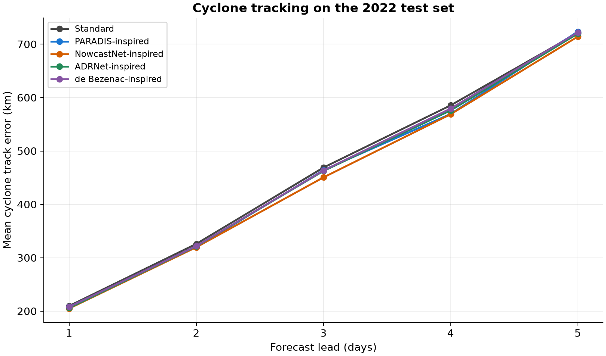
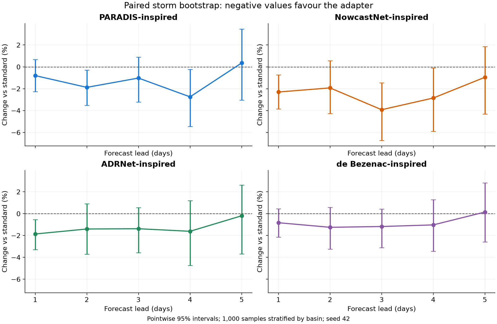
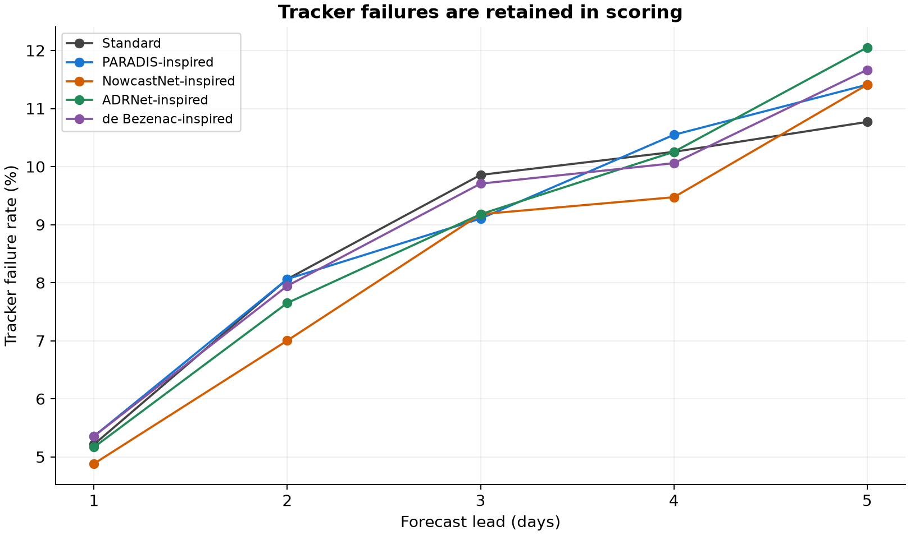
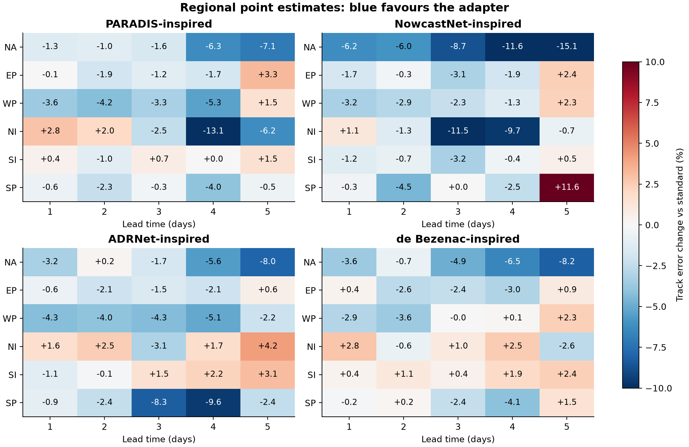
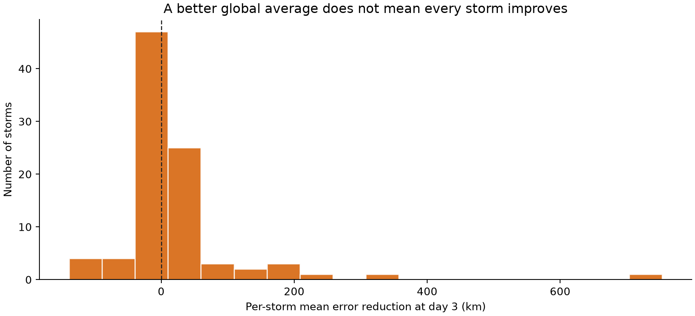
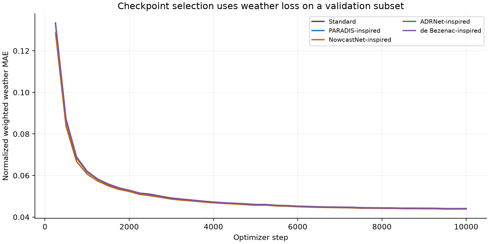

# Aurora Cyclone Advection Results

**Experiment:** HRES-T0 at 1.5°; train 2016–2020, validation 2021, test 2022. All five methods completed 10,000 optimizer steps with seed 42.

## Main findings

- **NowcastNet-inspired has the lowest global mean track error at all five leads.** Its largest relative reduction is **3.92% at 72 hours**, from **468.82 to 450.43 km** (**18.39 km** lower). The nominal paired-bootstrap 95% interval for the relative change is **−6.73% to −1.46%**.
- Paired intervals lie entirely below zero for **NowcastNet-inspired at days 1, 3 and 4**, **PARADIS-inspired at days 2 and 4**, and **ADRNet-inspired at day 1**.
- No global lead-time interval for de Bézenac-inspired excludes zero.
- **No adapter has a conclusive day-5 improvement** under the reported intervals. PARADIS-inspired and de Bézenac-inspired have slightly higher day-5 point-estimate errors than standard.

## Global track error

Mean position error in **km**; lower is better. Bold entries are the lowest point estimates, not evidence of superiority over every other adapter.

| Approach | Day 1 | Day 2 | Day 3 | Day 4 | Day 5 |
|---|---:|---:|---:|---:|---:|
| Standard | 209.67 | 325.86 | 468.82 | 585.35 | 720.98 |
| PARADIS-inspired | 207.99 | 319.74 | 464.01 | 569.27 | 723.54 |
| NowcastNet-inspired | **204.84** | **319.58** | **450.43** | **568.65** | **714.10** |
| ADRNet-inspired | 205.77 | 321.28 | 462.35 | 575.90 | 719.57 |
| de Bezenac-inspired | 207.93 | 321.78 | 463.30 | 579.32 | 722.02 |



## Relative error change against standard

**Negative percentages favour the adapter.** An asterisk marks a nominal paired-bootstrap 95% interval entirely below zero. Intervals use 1,000 storm resamples stratified by basin; they are not adjusted for multiple comparisons.

| Approach | Day 1 | Day 2 | Day 3 | Day 4 | Day 5 |
|---|---:|---:|---:|---:|---:|
| PARADIS-inspired | -0.80% | -1.88% * | -1.03% | -2.75% * | +0.35% |
| NowcastNet-inspired | -2.30% * | -1.93% | -3.92% * | -2.85% * | -0.95% |
| ADRNet-inspired | -1.86% * | -1.41% | -1.38% | -1.61% | -0.20% |
| de Bezenac-inspired | -0.83% | -1.25% | -1.18% | -1.03% | +0.14% |



## Tracker failure rates

Percent of verifying cases flagged as failed at the scored step; lower is preferable. Failed cases remain in the distance scores.

| Approach | Day 1 | Day 2 | Day 3 | Day 4 | Day 5 |
|---|---:|---:|---:|---:|---:|
| Standard | 5.22% | 8.06% | 9.86% | 10.25% | 10.77% |
| PARADIS-inspired | 5.36% | 8.06% | 9.10% | 10.55% | 11.41% |
| NowcastNet-inspired | 4.88% | 7.00% | 9.18% | 9.47% | 11.41% |
| ADRNet-inspired | 5.17% | 7.65% | 9.18% | 10.25% | 12.05% |
| de Bezenac-inspired | 5.36% | 7.95% | 9.71% | 10.06% | 11.67% |

NowcastNet-inspired lowers the day-4 failure rate from **10.25% to 9.47%**, but raises the day-5 rate from **10.77% to 11.41%**. Failure-rate differences have not been tested for statistical uncertainty.



## Basin and storm results

Regional gains vary by basin and lead; the heatmaps show point estimates rather than significance. Long-lead regional samples can be small: day 5 includes only four South Pacific storms and eight North Atlantic storms.



At day 3, NowcastNet-inspired lowers the per-storm mean error for **56 of 91 storms** and increases it for **35**. The median per-storm error reduction is **4.87 km**. This equal-storm summary differs from the case-weighted global reduction of 18.39 km.



## Validation loss and training cost

Recorded on an RTX A6000. Step times are log-derived medians, not a controlled hardware benchmark. Peak GiB is PyTorch allocated memory, not total GPU board usage.

| Approach | Best validation weather loss | Median seconds per optimizer step | Peak memory GiB |
|---|---:|---:|---:|
| Standard | 0.044086 | 4.76 | 26.19 |
| PARADIS-inspired | 0.043979 | 4.73 | 26.31 |
| NowcastNet-inspired | 0.043832 | 6.82 | 27.46 |
| ADRNet-inspired | 0.044007 | 4.79 | 26.31 |
| de Bezenac-inspired | 0.043996 | 5.37 | 26.42 |

NowcastNet-inspired has the lowest saved validation weather loss but takes approximately **43% more median time per optimizer step** than standard in these logs.



## Evaluation coverage

All five methods were evaluated on identical saved case keys and observed positions. The saved tracks contain 1,140 distinct initialization times per method; logs report 1,144 attempted initialization times. Each method has 29,952 saved six-hourly verification rows, including intermediate leads outside the five reported days.

| Lead | Scored cases | Distinct storms |
|---|---:|---:|
| 24 h | 2109 | 109 |
| 48 h | 1699 | 102 |
| 72 h | 1329 | 91 |
| 96 h | 1024 | 80 |
| 120 h | 780 | 62 |

## Global cyclone track RMSE

Track RMSE is the square root of the mean squared great-circle position error, in kilometres. It gives greater weight to large misses than track MAE. These values use the same 2022 verification cases and include persisted positions on tracker failure. The saved confidence intervals in this report apply to MAE.

| Approach | 24 h | 48 h | 72 h | 96 h | 120 h |
|---|---:|---:|---:|---:|---:|
| Standard | 289.45 | 452.84 | 661.80 | 821.99 | 985.54 |
| PARADIS-inspired | 287.97 | 440.79 | 651.76 | 803.64 | 1001.79 |
| NowcastNet-inspired | 281.26 | 446.23 | 632.20 | 798.04 | 978.37 |
| ADRNet-inspired | 280.81 | 444.37 | 638.65 | 792.84 | 974.34 |
| de Bézenac-inspired | 284.02 | 445.80 | 648.66 | 808.48 | 976.58 |

[Exact RMSE values and case counts](data/track_rmse_km.csv)

NowcastNet-inspired has the lowest 72-hour RMSE (632.20 km versus 661.80 km for standard). ADRNet-inspired has the lowest RMSE at 24, 96 and 120 hours. PARADIS-inspired leads at 48 hours.

## Published Aurora 0.25° reference

Bodnar et al. evaluated deterministic Aurora fine-tuned on HRES-T0 at 0.25° using IBTrACS tracks for 2022–2023. Their Nature paper reports 6% lower track MAE at day 1 and 20–25% lower track MAE at days 2–5 against official forecasts in the North Atlantic and East Pacific. Figure 4a reports pairwise relative MAE against agency forecasts. Their cases, issue timing and resolution differ from this repository's matched global 2022 evaluation. [Nature paper, Figure 4 and tropical cyclone results](https://www.nature.com/articles/s41586-025-09005-y.pdf) · [Supplement, Section I.3](https://api.repository.cam.ac.uk/server/api/core/bitstreams/66e515f4-f522-4b5c-a7c4-bf1b5ae2622f/content)

## Multi-step training

All five completed runs used two autoregressive six-hour training steps, supervising forecasts at +6 and +12 hours. Their saved configuration has `rollout_steps: 2` and `detach_every: 0`, so gradients flow through both steps. The 24–120-hour scores above come from longer inference rollouts. A controlled comparison with a longer training horizon still requires a new GPU run.

The [four-step config](../configs/cyclone_4step.json) keeps the original split and training settings while extending supervision to +24 hours. Use the same configuration for both approaches and separate output directories.

```bash
python scripts/finetune_standard.py --config configs/cyclone_4step.json --output runs/cyclone/standard_4step_seed42
python scripts/finetune_nowcastnet.py --config configs/cyclone_4step.json --output runs/cyclone/nowcastnet_4step_seed42
```

## Ten-day follow-up plan

| Days | Work |
|---|---|
| 1–2 | Use the shared four-step config for standard and NowcastNet-inspired. Run memory and throughput checks on the A6000. |
| 3–6 | Train both variants at +6, +12, +18 and +24 hours on the existing split. Keep the optimizer-step budget and checkpoint-selection rules fixed for the comparison. |
| 7–8 | Evaluate against the same 2022 IBTrACS cases. Compare MAE and RMSE with the existing two-step runs and record training cost. |
| 9–10 | Verify the tables and figures, document the results and package the report and source code for submission. |

## Interpretation

The NowcastNet-inspired adapter is the strongest candidate from this run, with modest short-to-medium-lead gains. The results are based on **one seed and one test year**, with unadjusted pointwise intervals. Its extra auxiliary loss also means the gain cannot yet be attributed solely to transport. Multi-seed replication and matched ablations are needed for a general claim.

Exact values: [global scores](data/global_scores.csv), [paired global and basin comparisons](data/paired_comparisons.csv), [training summary](data/training_summary.csv).
