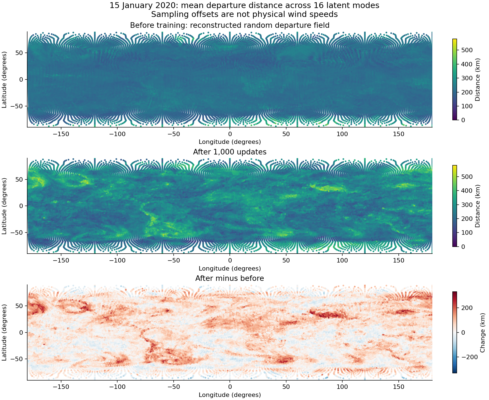
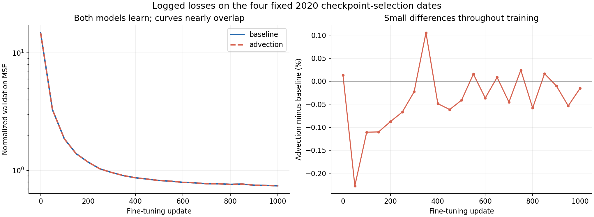

# GraphCast weather forecasting results

Return to the [workflow README](../README.md) for architecture and run commands.

### Metrics and validation

Area-weighted RMSE takes the square root of pooled squared forecast errors, in the field's physical units. ACC is the spatial correlation of forecast and target anomalies relative to ERA5 climatology. It averages over forecast dates, is dimensionless, and improves toward one. The frozen benchmark uses a 12 UTC initialization on the 15th of every month in 2020–2022. RMSE covers all 37 pressure levels; ACC uses the 13 supported climatology levels plus surface fields.

| Normalized checkpoint-selection loss | Direct | Advection |
|---|---:|---:|
| Before fine-tuning | 14.84619141 | 14.84814453 |
| Update 1,000 | 0.74183655 | 0.74172211 |

These losses use four fixed validation windows. The physical metrics below use the larger 36-date benchmark. The direct and advection checkpoints were selected at update 1,000. See the [training record](../docs/training-stage1.md) and [evaluation methodology](../docs/evaluation-methodology.md).

## GraphCast baseline vs advection: completed RMSE and ACC benchmark

Both checkpoints were evaluated successfully on 36 matched initializations: 12 monthly dates in each of 2020, 2021 and 2022. Forecasts are six hours ahead on the 1° grid. This is a sampled benchmark, not every forecast in those years.

Lower RMSE and higher ACC are better. RMSE is in the units shown; ACC is dimensionless. Both models completed 1,000 fine-tuning updates. Best checkpoints were chosen using 2020 validation only, before test evaluation.

### 2020 validation

| Variable | Units | Baseline RMSE | Advection RMSE | Baseline ACC | Advection ACC |
|---|---|---:|---:|---:|---:|
| 2 m temperature | K | 0.58369 | 0.58381 | 0.974572 | 0.974559 |
| 850 hPa temperature | K | 0.33977 | 0.33980 | 0.995053 | 0.995052 |
| 500 hPa geopotential | m²/s² | 22.66075 | 22.63036 | 0.999629 | 0.999630 |
| 10 m eastward wind | m/s | 0.48730 | 0.48717 | 0.992412 | 0.992415 |
| 10 m northward wind | m/s | 0.49767 | 0.49725 | 0.992509 | 0.992522 |
| Mean sea-level pressure | Pa | 32.50906 | 32.48933 | 0.998999 | 0.999000 |
| 6 h precipitation | mm | 1.16013 | 1.16032 | 0.879827 | 0.879835 |

### 2021 test

| Variable | Units | Baseline RMSE | Advection RMSE | Baseline ACC | Advection ACC |
|---|---|---:|---:|---:|---:|
| 2 m temperature | K | 0.59267 | 0.59262 | 0.975433 | 0.975437 |
| 850 hPa temperature | K | 0.33541 | 0.33545 | 0.995381 | 0.995382 |
| 500 hPa geopotential | m²/s² | 21.98004 | 21.98575 | 0.999601 | 0.999601 |
| 10 m eastward wind | m/s | 0.48198 | 0.48183 | 0.992056 | 0.992061 |
| 10 m northward wind | m/s | 0.49511 | 0.49462 | 0.992128 | 0.992144 |
| Mean sea-level pressure | Pa | 31.65369 | 31.68169 | 0.998920 | 0.998918 |
| 6 h precipitation | mm | 1.11768 | 1.11784 | 0.880217 | 0.880205 |

### 2022 test

| Variable | Units | Baseline RMSE | Advection RMSE | Baseline ACC | Advection ACC |
|---|---|---:|---:|---:|---:|
| 2 m temperature | K | 0.59732 | 0.59706 | 0.973112 | 0.973134 |
| 850 hPa temperature | K | 0.34418 | 0.34423 | 0.995157 | 0.995155 |
| 500 hPa geopotential | m²/s² | 23.57518 | 23.56355 | 0.999599 | 0.999600 |
| 10 m eastward wind | m/s | 0.48991 | 0.48988 | 0.992288 | 0.992289 |
| 10 m northward wind | m/s | 0.49888 | 0.49847 | 0.992746 | 0.992758 |
| Mean sea-level pressure | Pa | 33.21294 | 33.20532 | 0.998976 | 0.998977 |
| 6 h precipitation | mm | 1.07179 | 1.07178 | 0.883607 | 0.883641 |

### 2021-2022 test

| Variable | Units | Baseline RMSE | Advection RMSE | Baseline ACC | Advection ACC |
|---|---|---:|---:|---:|---:|
| 2 m temperature | K | 0.59500 | 0.59485 | 0.974273 | 0.974285 |
| 850 hPa temperature | K | 0.33982 | 0.33987 | 0.995269 | 0.995269 |
| 500 hPa geopotential | m²/s² | 22.79157 | 22.78831 | 0.999600 | 0.999601 |
| 10 m eastward wind | m/s | 0.48596 | 0.48587 | 0.992172 | 0.992175 |
| 10 m northward wind | m/s | 0.49700 | 0.49655 | 0.992437 | 0.992451 |
| Mean sea-level pressure | Pa | 32.44268 | 32.45245 | 0.998948 | 0.998948 |
| 6 h precipitation | mm | 1.09497 | 1.09506 | 0.881912 | 0.881923 |

### Scope and audit

RMSE covers all 37 pressure levels. ACC uses the published 1990–2019 ERA5 climatology at its 13 supported pressure levels, plus the five surface outputs. No climatology from validation/test years is used. All aggregate results were recomputed independently from saved per-date metric files; all 36 dates were present for both models and all reported metrics were finite.

The models have small, variable-dependent differences. This short-horizon monthly sample does not establish an overall advection advantage or multi-day skill. No statistical significance claim is made.

[All variables and levels (CSV)](../docs/results/evaluation/scores.csv) · [Frozen protocol](../docs/results/evaluation/protocol.json) · [Methodology](../docs/evaluation-methodology.md)

## Displacement and direct fine-tuning audit

Six forecast cases were compared on the same 12 monthly 2020 validation dates, at 1° and a six-hour horizon. Latent fields were measured on January, April, July and October dates. No training updates were run and no new test-year results were used for these diagnostics.

### Displacement before and after

- Mean latent departure distance: **215.39 → 263.08 km equivalent** (uniform mean over mesh nodes, 16 modes and four validation dates).
- The east/north displacement vectors changed by **149.82%** in relative L2 norm, averaged over dates. This includes both backbone-feature changes and displacement-network learning.
- Holding the final backbone features fixed and swapping only initial versus trained displacement weights changes the vectors by **6.64%** in relative L2 norm.
- Initial displacements are random and nonzero. The initial output projection is zero, so they initially add no latent correction.
- The trained correction RMS is **0.13411%** of backbone feature RMS.
- After materializing the actual BF16 decoder-input tensors, **41.917%** of mesh-feature components change. This is the fraction of components whose represented value changes, not the fraction of correction energy retained.

### Direct fine-tuning and controlled forecast comparisons

Direct fine-tuning changed 36,346,030 of 36,348,131 active parameter values (1.826% relative L2 change). The two trained backbones differ by 0.0962% in relative L2 norm.

#### 2 m temperature

| Case | RMSE (K) | ACC |
|---|---:|---:|
| Pretrained at 1° | 2.239944 | 0.6790606 |
| Direct fine-tuning | 0.583608 | 0.9745794 |
| Initial adapter replay | 2.239890 | 0.6790693 |
| Trained advection | 0.583768 | 0.9745622 |
| Trained advection, zero correction | 0.583783 | 0.9745618 |
| Trained advection, initial displacement weights | 0.583815 | 0.9745591 |

#### 850 hPa temperature

| Case | RMSE (K) | ACC |
|---|---:|---:|
| Pretrained at 1° | 2.518006 | 0.7050126 |
| Direct fine-tuning | 0.339805 | 0.9950519 |
| Initial adapter replay | 2.517938 | 0.7050297 |
| Trained advection | 0.339822 | 0.9950517 |
| Trained advection, zero correction | 0.339779 | 0.9950531 |
| Trained advection, initial displacement weights | 0.339808 | 0.9950522 |

#### 500 hPa geopotential

| Case | RMSE (m²/s²) | ACC |
|---|---:|---:|
| Pretrained at 1° | 247.263596 | 0.9543545 |
| Direct fine-tuning | 22.655146 | 0.9996292 |
| Initial adapter replay | 247.239898 | 0.9543639 |
| Trained advection | 22.625121 | 0.9996302 |
| Trained advection, zero correction | 22.626090 | 0.9996301 |
| Trained advection, initial displacement weights | 22.622214 | 0.9996303 |

The adapter-off comparison retains the trained advection backbone and zeros only the final lift matrix. The reset-displacement comparison retains that backbone, learned projection and learned lift, but restores the initial displacement linear weights/biases. These are evaluation-only ablations, not additional trained models.

### Repeatability check

Eight repetitions per case used identical 15 January 2020 inputs, weights and PRNG key. The current GPU/BF16 execution shows numerical variation between repeats. This does not establish BF16 casting alone as the cause; rounding itself is deterministic.

| Case | Mean 2 m temperature RMSE (K) | Repeat standard deviation (K) | Range (K) |
|---|---:|---:|---:|
| baseline | 0.62690550 | 0.00005672 | 0.62681256–0.62700354 |
| advection | 0.62722273 | 0.00006873 | 0.62714325–0.62733740 |
| advection_off | 0.62724559 | 0.00007207 | 0.62712937–0.62737533 |

The adapter-on/off RMSE gap is smaller than the per-date repeat variation measured here. The sample does not establish a meaningful incremental advection benefit. The direct-fine-tuning improvement is much larger. Recomputed baseline/advection scores differ slightly from the earlier benchmark, so the table above is the matched diagnostic rerun; it does not replace the original benchmark record.

### Reproducibility and limits

No epoch-zero adapter checkpoint was retained. Its parameters were reconstructed from the original pretrained backbone, the recorded seed and the exact training initializer; the Haiku shape and traversal order were checked. The original initial validation loss was 14.848144531; the replay produced 14.846191406. This small BF16 numerical difference is disclosed; the replay is not a saved epoch-zero artifact.

Only initial and final adapter parameters are available, so the plots do not establish the displacement trajectory at intermediate updates. The learning curves use the actual saved validation logs at every 50 updates. Latent capture calls the same normalized single-step network inside the autoregressive wrapper; all physical forecast comparisons use the unchanged production rollout. Checkpoint hashes were checked against the frozen evaluation.

[All validation scores](../docs/results/advection-diagnostics/scores.csv) · [Displacement statistics](../docs/results/advection-diagnostics/displacement.json) · [Parameter changes](../docs/results/advection-diagnostics/parameter_changes.json) · [Forecast differences](../docs/results/advection-diagnostics/prediction_effects.json)
